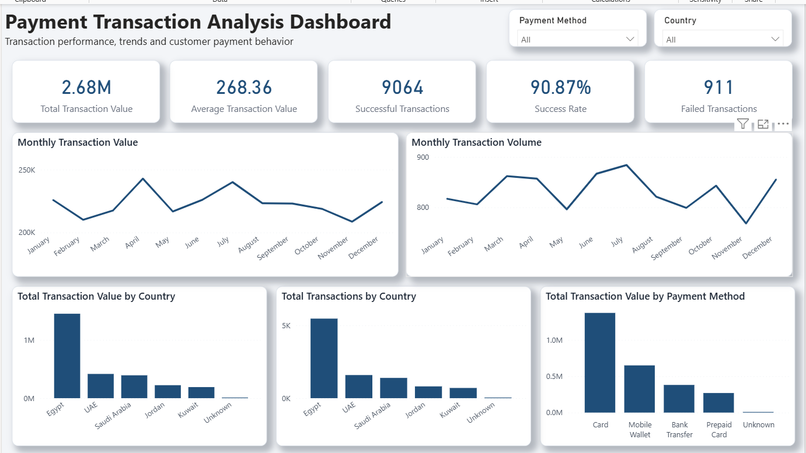
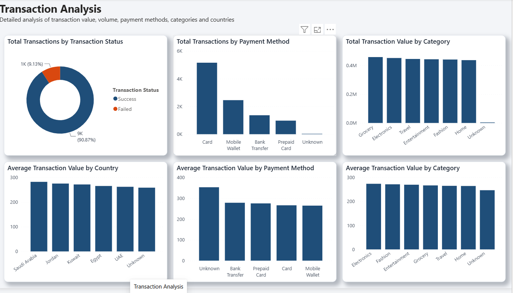
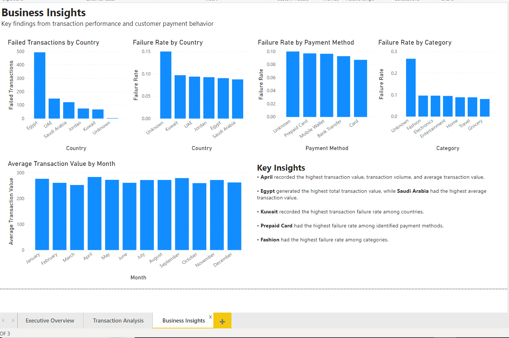

# Payment Transaction Analysis — Power BI Dashboard

An interactive Power BI dashboard that analyzes payment transactions to track performance, spot trends, and find where transactions fail most, by country, payment method and product category.

## Business Questions
1. How much transaction value and volume are we processing, and how is it trending month by month?
2. What is the overall success rate, and how many transactions fail?
3. Which countries, payment methods and categories drive the most value?
4. Where are failure rates highest, and what should the business look into?

## Dataset
- **Source:** Synthetic sample dataset (AI-generated) created for practice. It contains no real customer or company data.
- **Fields:** Date, Country, Payment Method, Category, Transaction Status, Transaction Amount

## Tools & Skills
- **Power BI:** data cleaning in Power Query, DAX measures, interactive slicers, multi-page report design, a custom report theme (consistent colors, card-style visuals) and sorted charts
- **KPI reporting:** success rate, failure rate, total and average transaction value

## Key DAX Measures
| Measure | Purpose |
|---|---|
| Total Transactions | Count of all transactions |
| Total Transaction Value | Sum of transaction amounts |
| Average Transaction Value | Average amount per transaction |
| Successful / Failed Transactions | Counts by transaction status |
| Success Rate / Failure Rate | Share of successful / failed transactions |

## Dashboard Pages
1. **Executive Overview:** headline KPIs, monthly value and volume trends, value by country and payment method, with country and payment method filters
2. **Transaction Analysis:** volume, value and average value by payment method, category and country; transaction status breakdown
3. **Business Insights:** failure analysis by country, payment method and category, plus key findings

All pages share one custom theme (dark blue for normal values, orange-red for failures).

## Design
- Custom theme: one main blue color, an orange-red accent used only for failed transactions and failure rates, light grey page background.
- KPI cards and charts shown as white cards with rounded corners and soft shadows.
- Bars sorted from highest to lowest so the biggest values are seen first.

## Key Insights
- **April** recorded the highest transaction value, volume and average transaction value.
- **Egypt** generated the highest total transaction value, while **Saudi Arabia** had the highest average transaction value.
- **Kuwait** had the highest failure rate among countries.
- **Prepaid Card** had the highest failure rate among payment methods.
- **Fashion** had the highest failure rate among categories.

## Recommendations
- Investigate payment gateway or bank issues in **Kuwait** to reduce failed transactions.
- Review **Prepaid Card** processing (balance checks, issuer declines) and consider prompting customers toward more reliable methods.
- Check the **Fashion** checkout flow for issues that may cause higher failure rates.
- Study what drove the **April** peak to repeat it in other months.

## Screenshots

### Executive Overview

### Transaction Analysis

### Business Insights

## How to Open
Download [`Seif_Abdelsalam_Payment_Transaction_Dashboard.pbix`](Seif_Abdelsalam_Payment_Transaction_Dashboard.pbix?raw=true) from this repo and open it in [Power BI Desktop](https://www.microsoft.com/power-platform/products/power-bi/desktop) (free).

---
**Author:** Seif Abdelsalam, Data Analyst
